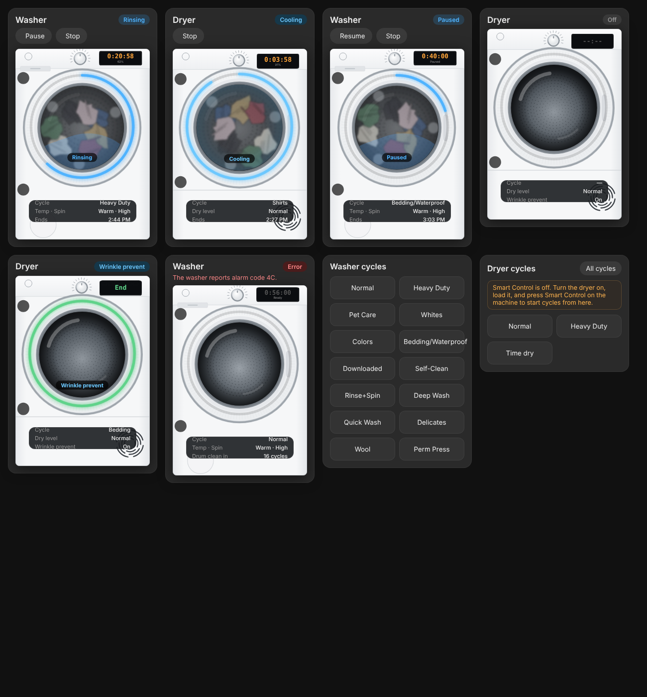

# Samsung Washer & Dryer Card for Home Assistant

Dashboard cards for Samsung washers and dryers connected through **[LocalThings](https://github.com/mbillow/localthings)**. Each card draws a front-loading machine. It shows the time left on the machine's display, a progress ring round the door and laundry turning in the drum, and has buttons to pause, resume, stop or start a cycle.

Adapted from the [hOn Washer & Dryer Card](https://mymediabuild.uk/home-assistant-washer-dryer-card/) by My Media Build. That card was made for Haier, Candy and Hoover machines; this one reads Samsung's LocalThings entities instead.



## What it shows

- **Time left** on the machine's display, counting down every second, with the percentage done underneath. Before a cycle starts it shows the selected cycle's length and "Ready".
- **A progress ring round the door**, filled from the machine's own progress percentage: blue for the washer, orange for the dryer, light blue while the dryer cools down or runs wrinkle prevent, and green when the cycle is finished.
- **The current phase** on the door glass: Weight sensing, Washing, Rinsing, Spinning, Drying, Cooling.
- **Cycle, temperature and spin speed** (washer) or **dry level** (dryer), plus the finish time. When the washer is idle it shows how many cycles are left before a drum clean; the dryer shows whether wrinkle prevent is on.
- **Smart Control and door-lock icons**, and an error message if the machine reports an alarm code.
- **Pause, Resume and Stop buttons** while a cycle runs. Stop asks first. Pause and Resume only appear when Smart Control is on; Stop works without it.
- **A cycles card**: the machine's cycles as buttons. Tap one, confirm, and it starts.

## Requirements

- The **LocalThings** integration (HACS). This card reads its entities: `sensor.*_machine_state`, `*_progress`, `*_progress_percent`, `*_estimated_finish`, `*_completion_time`, `select.*_cycle` and `button.*_start/_pause/_stop`.
- **Smart Control** switched on at the machine if you want to start, pause or resume it from Home Assistant. Samsung only accepts these commands while it is on: turn the machine on, load it, and press Smart Control. Without it the card still shows everything, and Stop still works.

The core SmartThings integration doesn't expose a cycle picker, progress percentage or Start/Pause buttons for these machines, so the card uses LocalThings.

## Install

### HACS

1. In HACS, open the three-dot menu and choose **Custom repositories**.
2. Paste this repository's URL and choose the type **Dashboard**.
3. Search for **Samsung Washer & Dryer Card**, download it, and reload your browser.

### Manual

1. Copy `samsung-laundry-card.js` to `config/www/samsung-laundry-card.js`.
2. Go to **Settings → Dashboards → ⋮ → Resources**, add `/local/samsung-laundry-card.js?v=1.0.0` as a **JavaScript module**, and reload your browser.

## Use

This puts each machine above its cycle buttons, washer on the left and dryer on the right:

```yaml
type: grid
columns: 2
square: false
cards:
  - type: vertical-stack
    cards:
      - type: custom:samsung-laundry-card
        appliance: washer
        max_width: 380px
      - type: custom:samsung-cycles-card
        appliance: washer
        favourites: ["01", "53", "65", "7c", "57", "04", "7d", "5e"]
  - type: vertical-stack
    cards:
      - type: custom:samsung-laundry-card
        appliance: dryer
        max_width: 380px
      - type: custom:samsung-cycles-card
        appliance: dryer
        favourites: ["01", "2f", "32", "07", "05", "06", "36", "33"]
```

The cards find your machines on their own: the washer is the LocalThings device with a `select.*_wash_temperature` entity, and the dryer the one with `select.*_dry_level`. If you have more than one of either, set `entity` to the start of the entity IDs, for example `entity: laundry_room_samsung_washer`.

### Options

| Option | Card | What it does |
|---|---|---|
| `appliance` | both | `washer` or `dryer` (required) |
| `entity` | both | Start of your entity IDs, e.g. `laundry_room_samsung_washer`. Found automatically if left out |
| `name` | both | Card title. Default Washer / Dryer |
| `colour` | both | Accent colour, e.g. `"#4fb3ff"` |
| `cycle_names` | both | Names for cycle codes that would otherwise show as "Cycle 47", e.g. `{ "47": "Towels" }` |
| `max_width` | machine | How wide the machine can get, e.g. `380px` |
| `style` | machine | `photo` (default, a detailed front-loader illustration) or `drawn` (a simple drawing) |
| `images` | machine | Folder with your own `washer.svg`, `dryer.svg` and `laundry-drum.webp`, e.g. `/local/myimg/` |
| `favourites` | cycles | Cycle codes to show as buttons. The others go behind **All cycles**. Default: every cycle the machine offers |

### Cycle codes

Samsung identifies cycles by short hex codes. LocalThings translates the ones it knows, and the card uses the same names you see in Home Assistant. On these machines:

| Washer | | Dryer | |
|---|---|---|---|
| `01` | Normal | `01` | Normal |
| `53` | Heavy Duty | `2f` | Heavy Duty |
| `88` | Pet Care | `32` | Perm Press |
| `7c` | Whites | `33` | Steam Sanitize+ |
| `65` | Colors | `05` | Bedding |
| `7d` | Bedding/Waterproof | `36` | Air Fluff |
| `17` | Downloaded | `06` | Time Dry |
| `7e` | Self-Clean | `07` | Delicates |
| `5e` | Rinse+Spin | `42`, `43`, `44`, `47` | not in LocalThings' list yet |
| `86` | Deep Wash | | |
| `04` | Quick Wash | | |
| `57` | Delicates | | |

To name an unknown code, pick that cycle on the machine, look at **select.…_cycle** in **Developer tools → States**, and add it to `cycle_names` on both cards:

```yaml
cycle_names:
  "47": Towels
```

Cycles downloaded through the SmartThings app (such as Wool or Perm Press on the washer) already show by name.

## Licence

MIT. Based on the hOn Washer & Dryer Card by My Media Build (MIT). Not affiliated with or endorsed by Samsung.
