<h1 align="center">🧺 Samsung Washer & Dryer Card</h1>

<p align="center">
  Home Assistant dashboard cards that draw your <b>Samsung washer and dryer</b> as the real machines:<br>
  the drum turning, time counting down, steam rolling, doors swinging open, and clothes waiting inside until you unload them.
</p>

<p align="center">
  <a href="https://hacs.xyz"></a>
  <a href="https://github.com/2tk785fryr-tech/washer-and-dryer/releases/latest"></a>
  
  
</p>

<p align="center">
  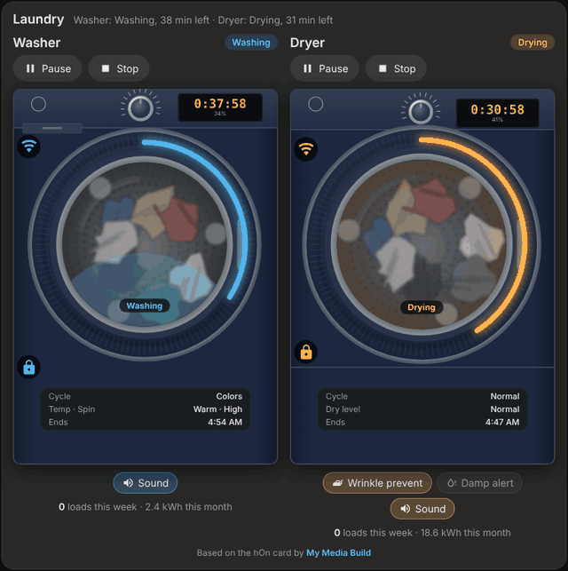
</p>

<p align="center">
  <a href="#-install">Install</a> ·
  <a href="#%EF%B8%8F-set-up">Set up</a> ·
  <a href="#%EF%B8%8F-what-it-shows">What it shows</a> ·
  <a href="#%EF%B8%8F-starting-a-cycle">Starting a cycle</a> ·
  <a href="#-door-sensor-extras">Door sensor extras</a> ·
  <a href="#-colours">Colours</a> ·
  <a href="#%EF%B8%8F-all-options">All options</a>
</p>

> **Credit:** based on the [hOn Washer & Dryer Card](https://mymediabuild.uk/home-assistant-washer-dryer-card/) by **[My Media Build](https://mymediabuild.uk)**. The original design, illustrations and animations are theirs. That card was made for Haier, Candy and Hoover machines; this version reads Samsung's LocalThings entities. If you like it, [buy them a coffee](https://buymeacoffee.com/bobgreggr) ☕.

---

## ✨ Highlights

- 🌀 **A living drum:** laundry tumbles at the speed of the phase. Slow while weighing, steady washing, a fast blur during spin as the water drains, and gentle tumbling while the dryer cools.
- ⏱️ **The machine's own display:** time left counting down every second and the percentage done, with a progress ring round the door. Blue for the washer, orange for the dryer, light blue while cooling, green when finished.
- ♨️ **Cycle effects:** steam fogging the glass and wisps rising from the door on a steam cycle; only white laundry on a Whites wash; water and no laundry on Self-Clean.
- 👕 **Clothes left inside:** "Wet clothes in the washer" / "Dry clothes in the dryer" with the laundry settled in the drum until the door opens (needs a door sensor). It survives Home Assistant restarts.
- 🚪 **Doors that open:** with a door sensor, the door swings out on its hinge.
- ▶️ **Start cycles your way:** pick a cycle, adjust its settings, and start now or set it to **finish by** a time.
- 📊 **Last cycle and weekly stats:** how long it ran and the energy it used; loads this week, your most-used cycle, and kWh this month.
- 🧽 **Drum-clean reminder** with a one-tap **Start Self-Clean**, and **quick toggles** for wrinkle prevent, damp alert and the end-of-cycle sound.
- 🎨 **Five colours:** White, Pearl, Onyx, Graphite and Midnight blue, or any colour you like.
- 📱 **Phone friendly:** the pair card keeps washer and dryer side by side even on an iPhone.
- 🔍 **Easy to share:** pick the machine in the editor and the card finds everything else, renamed entities included.

## 🖼️ What it shows

<table>
  <tr>
    <td width="33%" align="center">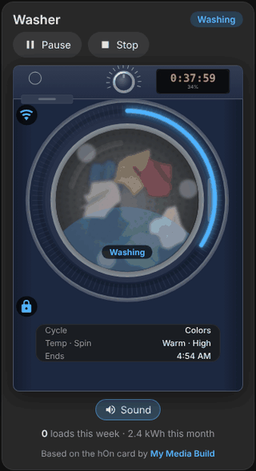<br><b>Washing → spin</b><br><sub>The drum speeds up into a blur and the water drains</sub></td>
    <td width="33%" align="center">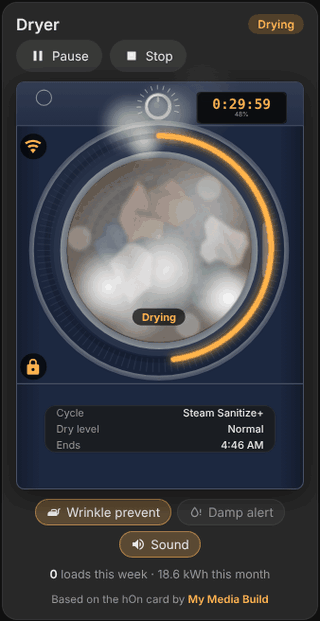<br><b>Steam cycle</b><br><sub>Fogged glass, steam inside, wisps over the door</sub></td>
    <td width="33%" align="center">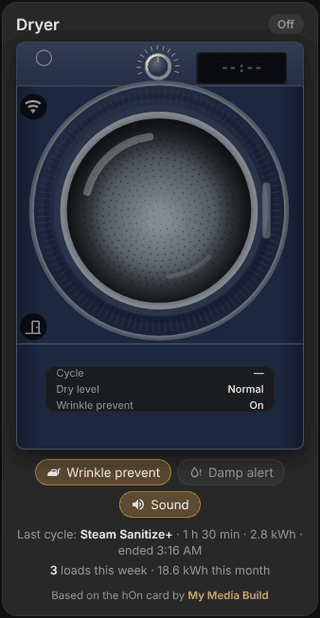<br><b>Door opening</b><br><sub>Needs a door sensor</sub></td>
  </tr>
  <tr>
    <td align="center">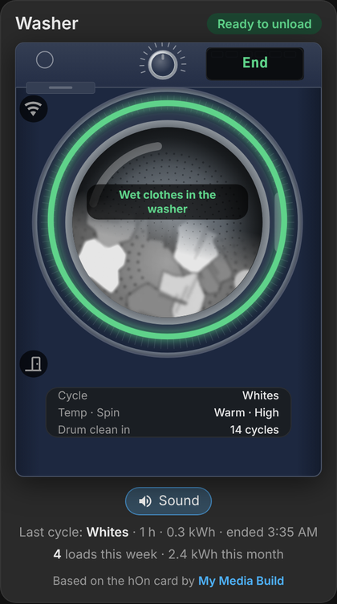<br><b>Clothes inside</b><br><sub>Green ring, "Ready to unload", laundry settled in the drum</sub></td>
    <td align="center">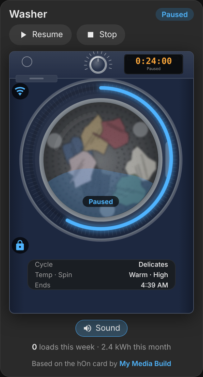<br><b>Paused</b><br><sub>Resume and Stop; Stop always asks first</sub></td>
    <td align="center">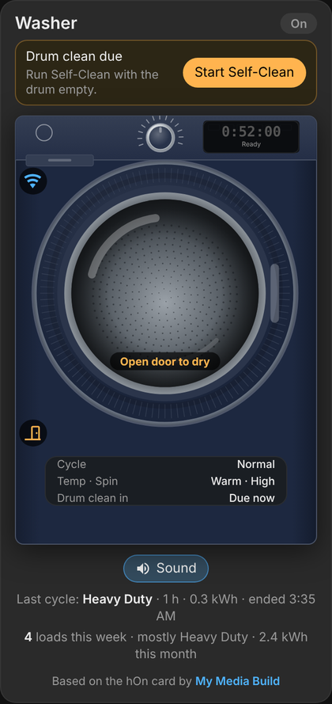<br><b>Drum clean due</b><br><sub>One tap starts Self-Clean, plus "Open door to dry"</sub></td>
  </tr>
</table>

| The machine is… | The card shows |
|---|---|
| Running | The phase on the glass (Weight sensing, Washing, Rinsing, Spinning, Drying, Cooling), time left, % done, the end time, and **Pause** and **Stop** |
| Paused | "Paused" on the display, the drum still, **Resume** and **Stop** |
| On a steam / Whites / Self-Clean cycle | Steam / only white laundry / water and no laundry |
| Finished, door still shut | **Ready to unload**, green ring, "Wet clothes in the washer" or "Dry clothes in the dryer" *(door sensor)* |
| Running wrinkle prevent | "Wrinkle prevent" in light blue, clothes still inside |
| Idle, door open | The door swung open *(door sensor)* |
| Idle washer, door shut | "Open door to dry", so the drum can air out *(door sensor)* |
| Reporting an alarm code | "Error" and the code |

Under each machine:

- 🔘 **Quick toggles:** Wrinkle prevent and Damp alert on the dryer, Sound on both. Tap to flip.
- 🕓 **Last cycle:** for example *Steam Sanitize+ · 1 h 30 min · 2.8 kWh · ended 2:23 PM*. Water too, on machines that report it.
- 📈 **This week:** for example *4 loads this week · mostly Heavy Duty · 2.4 kWh this month*.

## 📦 Install

### HACS (recommended)

1. In HACS, open the **⋮** menu and choose **Custom repositories**.
2. Paste `https://github.com/2tk785fryr-tech/washer-and-dryer` and choose the type **Dashboard**.
3. Search for **Samsung Washer & Dryer Card**, download it, and reload your browser.

HACS offers each new version as an update. See [Releasing an update](#-releasing-an-update).

### Manual

1. Download `samsung-laundry-card.js` from the [latest release](https://github.com/2tk785fryr-tech/washer-and-dryer/releases/latest) and copy it to `config/www/`.
2. Go to **Settings → Dashboards → ⋮ → Resources**, add `/local/samsung-laundry-card.js` as a **JavaScript module**, and reload your browser.

### You'll need

- **[LocalThings](https://github.com/mbillow/localthings)** (HACS) with your washer and/or dryer added. The card reads its entities; copies of the machines in the core SmartThings integration are ignored, because SmartThings doesn't expose the cycle picker, progress or buttons.
- **Smart Control** on at the machine to start, pause or resume it from Home Assistant: turn it on, load it, press Smart Control. Without it the card still shows everything, and Stop still works.
- *Optional:* a **door sensor** for the door extras, and an `input_boolean` that's on while laundry is waiting, as a backup for "clothes inside".

## 🛠️ Set up

**Edit dashboard → Add card**, search for **Samsung**, and pick a card:

| Card | What it is |
|---|---|
| **Samsung laundry** | One machine: the picture, status, Pause/Resume/Stop, toggles, last cycle and stats |
| **Samsung cycles** | The machine's cycles as buttons, with settings and Finish by |
| **Samsung laundry pair** | Washer and dryer side by side with a shared status line, optionally with their cycles cards |

In the editor choose **Washer** or **Dryer** and pick your machine under **Machine**. That's the LocalThings device; with one washer and one dryer you can leave it empty and the card finds them. The door sensor, the laundry-waiting helper, the colour and what to show are all in the same form.

Or in YAML, both machines in one card:

```yaml
type: custom:samsung-laundry-pair-card
body_colour: midnight_blue
cycles: true
```

<details>
<summary><b>Separate cards: each machine above its cycle buttons</b></summary>

```yaml
type: grid
columns: 2
square: false
cards:
  - type: vertical-stack
    cards:
      - type: custom:samsung-laundry-card
        appliance: washer
        body_colour: midnight_blue
      - type: custom:samsung-cycles-card
        appliance: washer
        favourites: ["01", "53", "65", "7c", "57", "04", "7d", "5e"]
  - type: vertical-stack
    cards:
      - type: custom:samsung-laundry-card
        appliance: dryer
        body_colour: midnight_blue
      - type: custom:samsung-cycles-card
        appliance: dryer
        favourites: ["01", "2f", "32", "07", "05", "06", "36", "33"]
```

</details>

<details>
<summary><b>Everything spelled out</b></summary>

```yaml
type: custom:samsung-laundry-card
appliance: dryer
device: 0123456789abcdef0123456789abcdef            # the LocalThings device (the editor's Machine picker)
name: Dryer
body_colour: onyx                                   # white, pearl, onyx, graphite, midnight_blue or "#rrggbb"
style: photo                                        # or drawn
max_width: 380px
door: binary_sensor.laundry_room_samsung_dryer_door_door
unload_helper: input_boolean.dryer_unacknowledged
door_hint: false
toggles: true
summary: true
stats: true
cycle_names:
  "47": Towels
entities:                                           # only if you need to override what the card found
  progress: sensor.laundry_room_samsung_dryer_progress
```

</details>

## ▶️ Starting a cycle

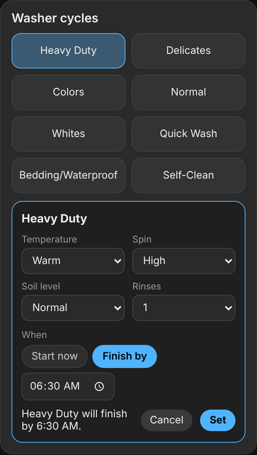

Tap a cycle on the cycles card:

1. 🔄 The cycle is **selected on the machine** straight away, so the settings narrow to what that cycle allows.
2. 🎛️ **Adjust its settings:** temperature, spin, soil level and rinses on the washer; dry level and dry time on the dryer. Changes go to the machine as you make them.
3. 🕕 **Choose when:** **Start now**, or **Finish by** a time (it suggests one; the machine works out the delay). Machines without a finish time get **Start later** with a delay in hours.
4. ✅ **Start** or **Set**.

It won't start while the machine is running, while the door is open, or without Smart Control, and it says which.

Pick the buttons you want with `favourites`. The rest go behind **All cycles**, with a search box.

<br clear="right">

## 🚪 Door sensor extras

Samsung machines don't report their door, so these need a contact sensor on the door (any integration; the card finds one named `<machine>_door_door` on its own, or pick it in the editor). Without one, everything else works the same.

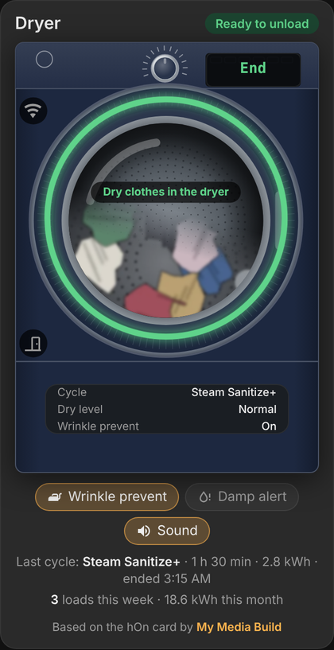

- 🚪 **The door swings open** on its hinge when it's open, and the door icon shows open, closed, or locked while a cycle runs.
- 👕 **Clothes inside:** after any cycle ends with the door still shut, the glass says **Wet clothes in the washer** or **Dry clothes in the dryer**, the label says **Ready to unload**, and the laundry settles still at the bottom of the drum until the door opens. Washer Self-Clean leaves the drum empty instead. A stopped cycle counts too (without the green ring).
- 🔁 **Survives restarts:** it's worked out from Home Assistant's recorded history, not from when things last changed. An optional `input_boolean` that's on while laundry is waiting backs it up when there's no history (by default `input_boolean.washer_unacknowledged` / `input_boolean.dryer_unacknowledged`, if you have them).
- 💨 **"Open door to dry"** on an idle washer with its door shut, so the drum doesn't get musty.
- ⛔ **No starting with the door open:** the cycles card waits for it to close.

<br clear="right">

## 📱 On your phone

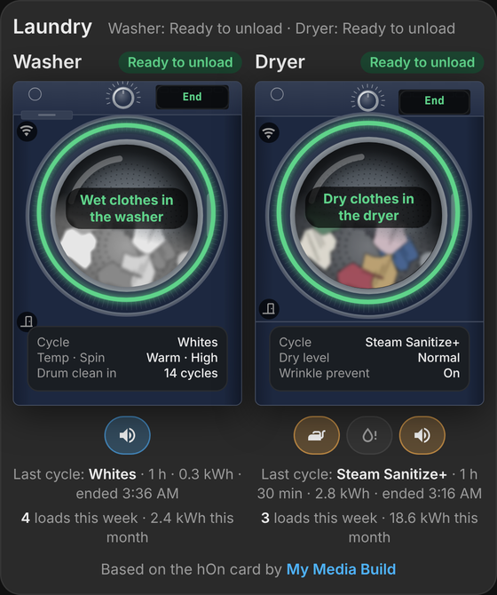

The pair card keeps the washer and dryer **side by side**, even on an iPhone Pro (402 points wide):

- Pause/Stop and the toggles become icon-only buttons, the text tightens up, and the info panel grows so everything fits.
- The two pictures stay level when only one machine is running.
- With `cycles: true`, the cycle buttons sit two to a row.

Wider cards keep the full labels.

<br clear="right">

## 🎨 Colours

<p align="center">
  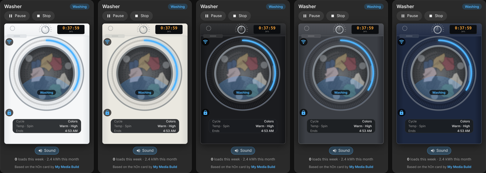<br>
  <sub>White (classic) · Pearl · Onyx · Graphite · Midnight blue</sub>
</p>

Pick one under **Look → Machine colour**, or set `body_colour` to `white`, `pearl`, `onyx`, `graphite`, `midnight_blue`, or any hex colour like `"#1d2840"`. The body, front panel, door surround and dial follow it; the chrome stays chrome.

## ⚙️ All options

<details open>
<summary><b>Machine and cycles cards</b></summary>

| Option | Default | What it does |
|---|---|---|
| `appliance` | `washer` | `washer` or `dryer` |
| `device` | found automatically | The LocalThings device (the editor's **Machine** picker) |
| `name` | Washer / Dryer | Card title |
| `colour` | blue / orange | Accent colour, e.g. `"#4fb3ff"` |
| `door` | `<machine>_door_door` if it exists | Optional door sensor, `on` = open. `false` turns it off |
| `cycle_names` | | Names for cycle codes that would otherwise show as "Cycle 47", e.g. `{ "47": "Towels" }` |
| `entities` | | Override any entity the card found, e.g. `{ progress: sensor.my_progress }`. The role names are the `ROLES` at the top of the card file |
| `entity` | | Older alternative to `device`: the start of the machine's entity IDs, e.g. `laundry_room_samsung_washer` |

</details>

<details>
<summary><b>Machine card</b></summary>

| Option | Default | What it does |
|---|---|---|
| `body_colour` | `white` | `white`, `pearl`, `onyx`, `graphite`, `midnight_blue`, or any hex colour |
| `style` | `photo` | `photo` (a detailed front loader) or `drawn` (a simple drawing) |
| `max_width` | `440px` | How wide the machine can get |
| `images` | | Folder with your own `washer.svg`, `dryer.svg` and `laundry-drum.webp`, e.g. `/local/myimg/` |
| `unload_helper` | `input_boolean.<machine>_unacknowledged` if it exists | Backs up "clothes inside" when there's no history. `false` turns it off |
| `door_hint` | `true` washer, `false` dryer | "Open door to dry" |
| `toggles` | `true` | Quick toggles |
| `summary` | `true` | Last cycle |
| `stats` | `true` | Weekly stats |

</details>

<details>
<summary><b>Cycles card</b></summary>

| Option | Default | What it does |
|---|---|---|
| `favourites` | every cycle | Cycle codes to show as buttons; the rest go behind **All cycles** |

</details>

<details>
<summary><b>Pair card</b></summary>

| Option | Default | What it does |
|---|---|---|
| `title` | Laundry | Card title |
| `washer_device`, `dryer_device` | found automatically | The two machines |
| `washer_door`, `dryer_door` | found automatically | Their optional door sensors |
| `cycles` | `false` | Each machine's cycles card underneath it |
| `washer`, `dryer` | | Options for one machine only, e.g. `washer: { name: Washing machine }` |

Any machine-card option (`body_colour`, `toggles`, `stats`, …) set on the pair card applies to both machines.

</details>

<details>
<summary><b>Cycle codes</b></summary>

Samsung identifies cycles by short hex codes. LocalThings translates the ones it knows, and the card shows the same names you see in Home Assistant. On the machines this was built with:

| Washer | | Dryer | |
|---|---|---|---|
| `01` | Normal | `01` | Normal |
| `53` | Heavy Duty | `2f` | Heavy Duty |
| `88` | Pet Care | `32` | Perm Press |
| `7c` | Whites | `33` | Steam Sanitize+ |
| `65` | Colors | `05` | Bedding |
| `7d` | Bedding/Waterproof | `36` | Air Fluff |
| `17` | Downloaded | `06` | Time Dry |
| `7e` | Self-Clean | `07` | Delicates |
| `5e` | Rinse+Spin | `42`, `43`, `44`, `47` | not in LocalThings' list yet |
| `86` | Deep Wash | | |
| `04` | Quick Wash | | |
| `57` | Delicates | | |

To name an unknown code, pick that cycle on the machine, look at **select.…_cycle** in **Developer tools → States**, and add it to `cycle_names`. Cycles downloaded through the SmartThings app already show by name.

</details>

## 👀 Preview without Home Assistant

Open [`demo/index.html`](demo/index.html) in a browser. The buttons switch between scenes (washing, spin, whites and steam, clothes inside, doors open, drum clean, paused), colours and layouts, and the cards' own buttons work too.

## 🚀 Releasing an update

Raise `SAMSUNG_CARD_VERSION` at the top of `samsung-laundry-card.js` and push to `main`. The **Release** workflow (`.github/workflows/release.yml`) then publishes a GitHub release tagged with that version, e.g. `v1.7.0`, and HACS offers it as an update. Pushes that don't change the version don't make a release.

---

<p align="center"><sub>MIT licence. Based on the hOn Washer & Dryer Card by <a href="https://mymediabuild.uk">My Media Build</a> (MIT); their copyright notice is kept in <code>LICENSE</code>.<br>Not affiliated with or endorsed by Samsung.</sub></p>
